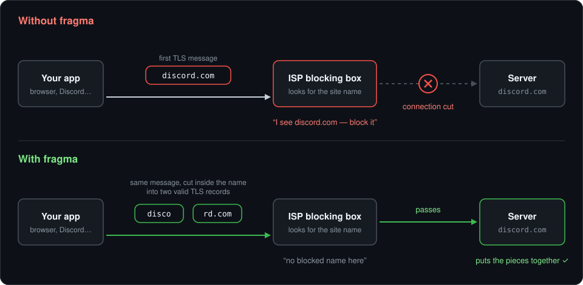
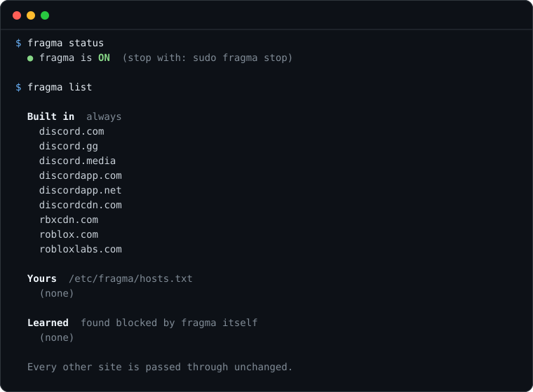

# fragma

**Open the sites your ISP blocks (Discord, Roblox, ...) with one command, and leave everything
else exactly as it is.**

[](https://github.com/vam0laa/fragma/actions/workflows/test.yml)
[](https://github.com/vam0laa/fragma/releases/latest)
[](LICENSE)

No VPN, no account, no telemetry. A [zapret](https://github.com/bol-van/zapret) / GoodbyeDPI
alternative, written in Go. **Linux** (system-wide) and **Windows** (experimental, via the system proxy).

[Install](#install) · [How it works](#how-it-works) · [Commands](#commands) ·
[Windows](#windows-experimental) · [Privacy](#privacy) · [Limitations](#limitations-please-read) ·
[Türkçe](#türkçe)

<p align="center">
  
</p>

## Install

```bash
curl -fsSL https://raw.githubusercontent.com/vam0laa/fragma/main/install.sh | sudo sh
```

This is for Linux; for Windows see [below](#windows-experimental). The command downloads the latest release, verifies its checksum, installs it and starts it. It also
starts at every boot. There is nothing to configure. The installer and all commands speak
**English or Türkçe**, chosen from your system language (force one with `FRAGMA_LANG=tr` or
`FRAGMA_LANG=en`). To turn it off:

```bash
sudo fragma stop        # off, nothing is redirected anymore
sudo fragma start       # on again
fragma status           # is it on?
sudo fragma uninstall   # remove everything
```

## What you see

<p align="center">
  
</p>

## Why fragma

- **Plug and run.** One command; Discord and Roblox are known out of the box, other blocked sites
  are found by themselves.
- **Surgical.** Only connections to blocked sites are changed. Everything else passes byte for byte.
- **Your traffic stays yours.** It is not sent through anyone's server, and DNS is left alone unless
  you ask.
- **Small enough to read.** Go, standard library only, with unit and end-to-end tests.

## Türkçe

<details>
<summary><b>Kısa Türkçe anlatım</b></summary>

<br>

**fragma, internet sağlayıcının engellediği siteleri (Discord, Roblox ...) tek komutla açar; diğer
her şeye dokunmaz.** VPN yok, hesap yok, telemetri yok.

**Nasıl çalışır?** Sağlayıcıdaki engel kutusu, bağlantının ilk mesajındaki site adını okuyup
bağlantıyı keser. fragma bu mesajı site adının ortasından iki geçerli parçaya böler: sunucu
parçaları birleştirir, engel kutusu adı göremez.

**Kurulum (Linux)**

```bash
curl -fsSL https://raw.githubusercontent.com/vam0laa/fragma/main/install.sh | sudo sh
```

| Komut | Ne yapar |
|---|---|
| `fragma status` | açık mı? |
| `sudo fragma stop` / `start` | kapat / tekrar aç |
| `sudo fragma add <site>` | bu siteyi de engelli say |
| `sudo fragma uninstall` | her şeyi kaldır |

**Bilmen gerekenler:** Yalnızca HTTPS (TCP) ve IPv4; Discord sesli görüşme gibi UDP trafiğine
dokunmaz. Site adına bakan engellere karşı çalışır, IP engellerine karşı çalışmaz. Windows sürümü (arka planda,
sistem proxy'si üzerinden çalışır) deneyseldir. Aracı bulunduğun yerin yasalarına uygun
kullanmak senin sorumluluğundadır.

</details>

## It only touches blocked sites

fragma changes only the connections to blocked sites, and needs no setup to do so.
(Zapret can do the same with its host lists; here it is the default.)

- A site that is **not blocked is passed through byte for byte**, unchanged.
- Sites that **are** blocked get their first TLS packet rewritten so the blocking box cannot read
  the site name. fragma knows Discord and Roblox out of the box.
- Any other blocked site is found **automatically**: if a normal connection is cut (the typical
  sign of a block) and the same connection works fragmented, fragma remembers that site.
- You can add sites yourself: `sudo fragma add example.com`. `fragma list` shows what fragma changes.

Some servers even refuse a fragmented hello. fragma notices that too, goes back to the plain
connection and remembers it, so sites that were never blocked keep working.

## Privacy

fragma is built so that nothing about you has to leave your machine:

- **No telemetry, analytics, accounts or update checks.** It never contacts a server of ours (there
  is none).
- **No logs of the sites you visit.** The service prints only "on" and "off".
- **Your traffic goes exactly where it was going.** fragma changes how the first packet is cut, not
  where it is sent.
- **DNS is not touched by default.** Your lookups keep going wherever they went before. If your ISP
  also poisons DNS, you can opt in with `sudo fragma dns on` (answers over DNS-over-HTTPS,
  Cloudflare by default, or your own: `sudo fragma dns on --doh https://your.server/dns-query`).
  Then your lookups go to that provider instead of your ISP. A test checks that with DNS off not a
  single request goes to a DoH server.
- The learned list stays on your machine (`/var/lib/fragma/learned.txt`).
- The only other network use is yours to trigger: the installer downloads from github.com (GitHub
  sees your IP like for any download, the checksum is verified), and `fragma probe` /
  `fragma experiment` contact a few public hosts and one DoH resolver to run their tests.
- It is a few thousand lines of Go and uses only the standard library. Read it.

## Does it work?

Measured on a real connection whose ISP blocks Discord and Roblox by SNI (not guessed). HTTPS
requests that got an answer, out of 15:

| Address | Direct | Through fragma |
|---|---|---|
| discord.com | 8 | **15** |
| www.roblox.com | 5 | **15** |
| apis.roblox.com | 3 | **15** |
| auth.roblox.com | 8 | **15** |

The block is intermittent, which is why a single try tells you nothing. The measurements also showed
that the usual trick of splitting the packet at the TCP level does **not** work against this ISP, while
splitting the TLS *record* does (30/30 vs about half). Your ISP may differ: run `fragma probe` and
`fragma experiment` to see what yours does.

## How it works

SNI-based DPI reads the host name from the first TLS packet and cuts the connection. For a blocked
site fragma rewrites that first packet as two valid TLS records, cut inside the host name. The
server reassembles them, the DPI box does not.

System-wide mode (what `install` sets up): an nftables rule sends outgoing HTTPS (TCP 443) through
fragma, which decides per connection, by the site name, whether to change anything, and forwards it to
its real destination. Local and LAN addresses are never touched, and fragma's own connections are
marked so they are not redirected back into itself.

## What it changes on your system

Nothing else than this, and `sudo fragma uninstall` removes the program and the service:

- `/usr/local/bin/fragma` and `/etc/systemd/system/fragma.service`
- `/etc/fragma/hosts.txt` (your own list, yours to edit) and `/var/lib/fragma/` (learned sites)
- an nftables table `ip fragma`, which exists only while the service runs (stopping the service,
  even a crash, removes it)

## Requirements

Linux with systemd and nftables, x86_64 or arm64. On Arch: `pacman -S nftables`.
If you would rather not pipe a script into a root shell, read
[`install.sh`](install.sh) first, or do it by hand:

```bash
curl -LO https://github.com/vam0laa/fragma/releases/latest/download/fragma-linux-amd64.tar.gz
curl -LO https://github.com/vam0laa/fragma/releases/latest/download/SHA256SUMS
sha256sum --ignore-missing -c SHA256SUMS
tar xzf fragma-linux-amd64.tar.gz && sudo ./fragma install
```

## Windows (experimental)

On Windows fragma runs in the background and sets itself as your **proxy**. No administrator
rights and no driver are needed. The code is tested on Windows by CI, but it has **not been tried
on many connections**. On one Windows 11 connection with SNI blocking and DNS blocking, Discord and
Roblox failed directly and answered 5 of 5 requests with `--dns`. Please tell us how it goes (open an issue).

1. Download `fragma-windows-amd64.zip` from the [latest release](https://github.com/vam0laa/fragma/releases/latest),
   compare it with `SHA256SUMS` (`certutil -hashfile fragma-windows-amd64.zip SHA256`) and unzip it.
   The program is not code-signed, so Windows SmartScreen or your antivirus may warn; you can also
   build it yourself with `go build`.
2. Open PowerShell in that folder and run `.\fragma.exe install`. It starts now and at every sign-in.
   To try it without installing: `.\fragma.exe start`, later `.\fragma.exe stop`.
3. If blocked sites still do not open, your ISP probably poisons DNS too (`fragma probe` shows it). Use
   `.\fragma.exe install --dns`; your name lookups then go to Cloudflare.

| Command | What it does |
|---|---|
| `fragma install` / `uninstall` | Copy to `%LocalAppData%\Programs\fragma` and start at sign-in / remove it. |
| `fragma start` / `stop` / `restart` / `status` | Turn it on or off. |
| `fragma run` | Like `start`, but in the current window (Ctrl+C stops). |
| `fragma add <site>`, `fragma list` | Same as on Linux. Files are in `%AppData%\fragma`. |
| `--dns` (for `install`, `start`, `run`) | Resolve names over DNS-over-HTTPS (Cloudflare). Off by default. |

**What it changes:** the current user's proxy settings (`127.0.0.1:8899`; plain HTTP is passed on unchanged; local and LAN
addresses bypassed) while it runs, a `fragma` entry under the user's `Run` registry key after
`install`, and a temporary `RunOnce` entry. Your previous proxy settings are saved first and put back
by `stop`; after a crash by a small guard process; after a reboot or power loss at the next sign-in.
If another proxy or setup script is already configured, fragma refuses to start.

**Apps that ignore the proxy** (the Discord desktop app's updater does): run `fragma apps on` once and
approve the administrator prompt. It adds a marked block to the Windows hosts file that points a few
Discord names at your own machine, where fragma relays them and looks up the real address over
DNS-over-HTTPS (Cloudflare), also without `--dns`. Those names work only while fragma runs. Remove the
block with `fragma apps off` (`uninstall` does it too).

**Limits:** only programs that follow the Windows proxy settings go through fragma (browsers do;
some apps and games do not; see `fragma apps` above for Discord). VPN and dial-up connections have their own proxy settings,
which are not changed. `fragma proxy` still starts only the local proxy, without touching Windows.
Where you need packet-level handling, use GoodbyeDPI.

## fragma and Zapret

Both get around SNI-based blocks, in different ways. Neither is "better": they suit different cases.

| | Zapret | fragma |
|---|---|---|
| Approach | Packet level (NFQUEUE): fake packets, TTL tricks, splitting, reordering. Also a proxy mode (`tpws`) | Transparent proxy: rewrites the first TLS message into two valid TLS records |
| Techniques | Many; you pick what works on your ISP (`blockcheck` helps) | One: TLS record fragmentation |
| UDP / QUIC / IPv6 / HTTP (port 80) | Yes | No |
| Platforms | Linux, OpenWrt routers, BSD, macOS, Windows | Linux. Windows: experimental, system proxy |
| Setup | Pick a strategy, edit a config | None for the typical case |
| Only blocked sites | Yes, with host lists / auto host list | Yes, by default |
| Overhead | Typically only the first packets of a connection | Every HTTPS (port 443) connection is relayed by fragma |
| Size | C, large feature set | Go, a few thousand lines, standard library only |

**Choose fragma** for a desktop Linux machine, an SNI-based block (Discord, Roblox, ...) and a simple,
no-configuration tool. **Choose Zapret** for UDP/QUIC blocks, routers, BSD/macOS, difficult ISPs, or when you want
to tune the technique yourself.

On the connection we measured, Zapret's installed strategy (fake packets with a short TTL) did not help while TLS
record fragmentation did. That is one ISP and one strategy: another Zapret strategy may well work there too.

## Limitations (please read)

- **HTTPS (TCP) only.** UDP traffic is not touched. That includes Discord voice/video calls and
  probably Roblox in-game traffic. On the ISP we tested, Discord voice works without any help
  because that ISP blocks only the HTTPS side; an ISP that also blocks UDP is not covered yet.
- Automatic detection recognises blocks that **cut the connection** (reset). A block that silently
  drops packets is not detected; add such a site by hand with `sudo fragma add`.
- IPv4 only for now. It cannot help against blocks by IP address, only against SNI blocking (and
  DNS blocking if you turn on `fragma dns`).
- Do not run another tool that rewrites the same traffic (for example Zapret) at the same time as fragma; use one of them.
- It only changes how *your own* connection is written to the network. You are responsible for
  using it in line with the laws and terms of service that apply to you.

## Commands

| Command | What it does |
|---|---|
| `sudo fragma install` / `stop` / `start` / `uninstall`, `fragma status` | Install and control the background service. |
| `sudo fragma add <site>` | Also treat this site as blocked (applies within 10 seconds). |
| `fragma list` | Show the built-in, your own and the learned sites. Every other site is untouched. |
| `sudo fragma dns on [--doh URL]` / `off` | Optional DNS-over-HTTPS, off by default. |
| `fragma probe` | For each site: is DNS poisoned? IP blocked? SNI blocked? Every test is repeated 3 times because DPI is often intermittent. |
| `fragma experiment [hosts...]` | Tries 6 ways of sending the TLS ClientHello, 10 times each, and prints success counts. |
| `fragma proxy [--listen 127.0.0.1:8899] [--add site]` | A local HTTPS proxy for a single app, no root needed (for example `discord --proxy-server=http://127.0.0.1:8899`). [`docs/proxy.pac`](docs/proxy.pac) sends only blocked sites through it. |
| `sudo fragma run [--dns] [--doh URL] [--hosts FILE] [--state DIR]` | System-wide mode in the foreground (the service runs this). |

## Development

```bash
make test       # unit tests
make e2e        # end-to-end test of the system-wide mode in a private network namespace
make release    # static linux amd64/arm64 binaries + SHA256SUMS in dist/
```

`make e2e` needs no root and never touches your real network: it builds a fake blocked site, an
innocent one, a LAN device, a DPI box and a lying DNS server inside `unshare -Urn`, and checks that
the real binary fragments only what it should, learns a blocked site, leaves DNS alone by default
and removes its rules on stop.

## Roadmap

- [x] Windows background mode through the system proxy
- [ ] Windows packet-level mode for apps that ignore the proxy (needs a driver such as WinDivert)
- [ ] UDP / QUIC support (voice, games)
- [ ] IPv6
- [ ] Detect silent-drop blocks
- [x] English / Türkçe messages
- [ ] AUR package

## License

[MIT](LICENSE) © 2026 vam0laa
